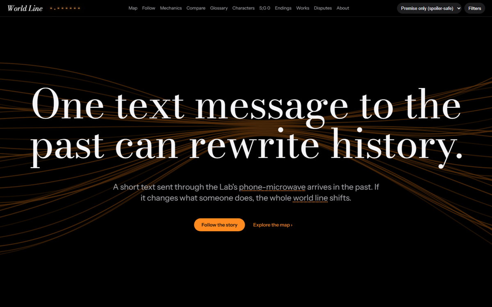
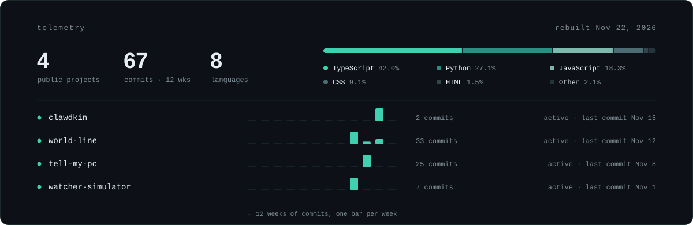

<picture>
  <source media="(prefers-color-scheme: dark)" srcset="assets/header-dark.svg">
  <source media="(prefers-color-scheme: light)" srcset="assets/header-light.svg">
  
</picture>

I like finding out how systems actually work, then building something small and real on top of them. Lately that means AI agents that run safely on my own machine, browser apps that explain complicated things, and anything that connects software to the physical world.

Computer Systems Technician graduate from Humber Polytechnic, working toward cloud infrastructure, security and systems roles.

 

## Selected work

### [tell-my-pc](https://github.com/0HBrar0/tell-my-pc) &nbsp;·&nbsp; Python · v1.3.0

Say *"Hey Siri, Tell Claude"*, dictate a task, put the phone away. A self-hosted daemon runs it with Claude Code on its own git branch and pushes a short report back to the phone.

The interesting part is containment: every tool call passes through a hook that enforces permission tiers (read, work, ask-on-phone, never), credential files and system folders are off-limits, and the list of changed files comes from `git diff`, not from the model. Design choices are written up as decision records alongside a threat model.

`Python 3.12` `Starlette` `Tailscale` `ntfy` `pytest` · [docs](https://0hbrar0.github.io/tell-my-pc/) · [threat model](https://github.com/0HBrar0/tell-my-pc/blob/main/docs/threat-model.md)

### [clawdkin](https://github.com/0HBrar0/clawdkin) &nbsp;·&nbsp; JavaScript · v0.1.2

A small desktop companion that sits on the taskbar and shows what Claude Code is doing: it works while Claude works, hops and holds up a `!` when Claude needs approval, and gets up to mischief in between. Hover for a thought cloud with the current file or command, so a long task can run without watching the terminal.

Under the playfulness is a careful local pipeline: Claude Code hooks write small state files that an Electron app reads, nothing leaves the machine, and the hooks never block Claude, even when they fail. CI runs the tests on Windows, macOS and Linux.

`Electron` `Node.js` `Claude Code hooks` `GitHub Actions` · [watch the demo →](https://github.com/0HBrar0/clawdkin#readme)

### [world-line](https://github.com/0HBrar0/world-line) &nbsp;·&nbsp; TypeScript · live

An interactive, spoiler-safe explainer of the *Steins;Gate* time-travel story: a branching world-line map, animated mechanic walkthroughs, and a guided story mode. Every story fact comes from one validated data file and shows a confidence badge linking to its sources, and spoiler tiers keep later content out of the page entirely until you unlock it.

`React` `TypeScript` `Zod` `Framer Motion` `Vitest` `Playwright` · [open the site →](https://0hbrar0.github.io/world-line/)

 

## On the bench

Not public yet, so treat these as directions rather than results.

- **Audiolocate** — can a sound recording be placed on a map from acoustic evidence alone? Signal processing, physical models and reference data.
- **Bioverse** — an early concept for an explorable biological atlas with 3D anatomy and cited sources.

 

## Telemetry

<picture>
  <source media="(prefers-color-scheme: dark)" srcset="assets/telemetry-dark.svg">
  <source media="(prefers-color-scheme: light)" srcset="assets/telemetry-light.svg">
  
</picture>

LATEST COMMITS 
<!-- log:start -->
`2026-11-23` &nbsp; [clawdkin](https://github.com/0HBrar0/clawdkin) &nbsp; [Code sprint: keep its typing words from piling up](https://github.com/0HBrar0/clawdkin/commit/379f8b14644e5c5a0d586e1be19628022d5572b9) 
`2026-11-23` &nbsp; [clawdkin](https://github.com/0HBrar0/clawdkin) &nbsp; [Clawdkin 0.1.2: one right-click card, six new tricks](https://github.com/0HBrar0/clawdkin/commit/85d66dea8c8832c43dbfb6226c2b68eb3c1433d7) 
`2026-11-15` &nbsp; [clawdkin](https://github.com/0HBrar0/clawdkin) &nbsp; [Log errors to ~/.clawdkin/errors.log, isolate test instances, tidy up](https://github.com/0HBrar0/clawdkin/commit/a738984abc3042d8b130febf7cc45441cd364840) 
`2026-11-15` &nbsp; [clawdkin](https://github.com/0HBrar0/clawdkin) &nbsp; [Clawdkin 0.1.0](https://github.com/0HBrar0/clawdkin/commit/aec1905d1a32242b4d2d8b70cc74523ddf892bf7) 
`2026-11-12` &nbsp; [world-line](https://github.com/0HBrar0/world-line) &nbsp; [Rope map and a readable top bar on phones](https://github.com/0HBrar0/world-line/commit/80fd2d1c7378a030be2b504e0fb400417ee8b0ae) 
`2026-11-11` &nbsp; [world-line](https://github.com/0HBrar0/world-line) &nbsp; [Redraw the mechanic animations as ink diagrams](https://github.com/0HBrar0/world-line/commit/99eed8280a91b529f7b0a98417643db0b753f561) 
<!-- log:end -->

This section rebuilds itself every day: a [GitHub Action](.github/workflows/build.yml) runs a [small Python script](scripts/build.py) against the GitHub API and redraws the panel. No third-party widgets.

 

## Toolkit

**Use regularly** — Python · TypeScript / React · Git & GitHub Actions · Linux & the command line · Windows & PowerShell 
**Solid on the fundamentals** — Networking · SQL & databases · AWS · security fundamentals 
**Learning now** — Cloud infrastructure, DevOps & SRE · operating systems · AI agent tooling · algorithms

## Credentials

- **Humber Polytechnic** — Computer Systems Technician
- **AWS** Certified Cloud Practitioner
- **ISC2** Certified in Cybersecurity (CC)

 

Reach me here on GitHub: opening an issue on any repo is the best way.

<!--
  Contact links: add yours on the line above when ready, e.g.
  <a href="https://www.linkedin.com/in/YOUR-HANDLE/">LinkedIn</a>
-->
